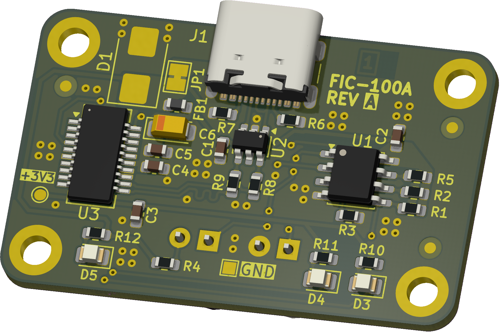
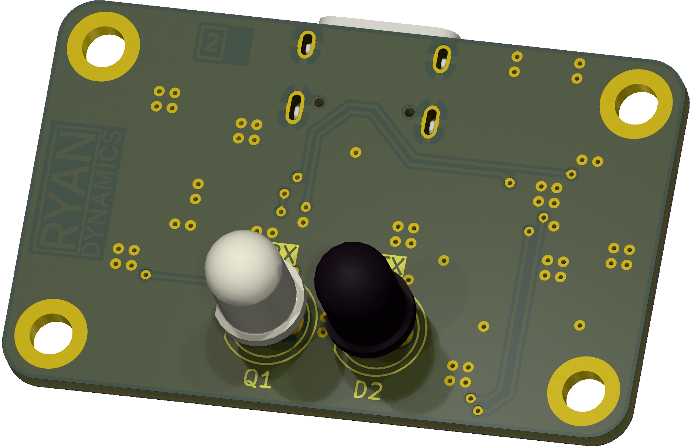

  

<h1 align="center">FIC-100A</h1>

   

  
&nbsp; &nbsp; &nbsp; &nbsp;
  

---

## Project Details

| Item | Value |
| --- | --- |
| Project name | FLUKE IR |
| PCBA name | FIC-100A |
| PCB name | FIC-100A |
| Drawing number | FIC-100A |
| Document type | SCHEMATIC |
| Drawing revision | A |
| Board revision | A |
| Release version | 0.1.3 |
| Variant | RELEASED |
| Dimensions | 40.0 x 25.0 mm |

---

## Project Outputs

GitHub Actions generates the manufacturing, schematic, test, and release packages.

The source branch contains the KiCad project and the Boardwright configuration.

Use these links to get outputs or inspect a workflow:

- [Latest release](https://github.com/Reemuson/boardwright-ci-test/releases/latest)
- [Release package](https://github.com/Reemuson/boardwright-ci-test/releases/latest/download/boardwright-0.1.3-release.zip)
- [Preview workflow](https://github.com/Reemuson/boardwright-ci-test/actions/workflows/dev-preview.yaml)
- [Accepted outputs workflow](https://github.com/Reemuson/boardwright-ci-test/actions/workflows/main-outputs.yaml)
- [Prepare release workflow](https://github.com/Reemuson/boardwright-ci-test/actions/workflows/prepare-release.yaml)
- [Publish release workflow](https://github.com/Reemuson/boardwright-ci-test/actions/workflows/release.yaml)

## Fabrication Summary

FABRICATION SNAPSHOT
- Board size: 40.000 x 25.000 mm
- Thickness: 1.600 mm
- Surface finish: ENIG
- Soldermask color: GREEN
- Silkscreen color: YELLOW
- Minimum PTH drill: 0.600 mm
- Minimum NPTH drill: 0.650 mm
- Impedance: no impedance controlled traces

## Component Summary

COMPONENT SNAPSHOT
- THT: 4 front, 2 back, 6 total
- SMT: 35 front, 0 back, 35 total
- Total: 39 front, 2 back, 41 total

---

## Legal Information

This repository can contain hardware design files, protected project branding, and third-party workflow content.

- Read `LICENSE` for the primary hardware licence.
- Read `NOTICE.md` for project scope, branding, compatibility, non-affiliation, and safety information.
- Read `THIRD_PARTY_NOTICES.md` for third-party copyright and licence notices.
